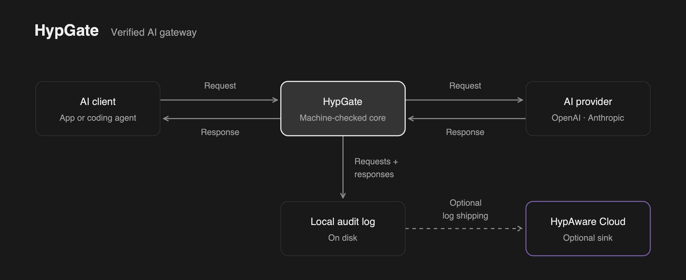

# HypGate - Formally Verified AI Gateway

HypGate is a small LLM gateway with a machine-checked core. It forwards request
bodies to your provider unchanged, streams responses back, writes every
exchange to an audit log on disk, and optionally ships that log to
[HypAware](https://hypaware.ai) for analysis or an S3 bucket. No provider API translation, no
plugins, no other network destinations.



The gateway's decision-making core is proved correct with
[Verus](https://github.com/verus-lang/verus). The network and disk adapters
around it are tested and audited.

## Three guarantees

### 1. Data only goes where you configured

Requests go to your configured provider using your configured credential.
Audit logs stay on disk unless you enable shipping to HypAware or S3.
There are no other network destinations.

### 2. Faithful forwarding and audit records

Request and response bodies pass through byte for byte, in order, including
streaming responses. The gateway filters headers and supplies the provider
credential. Audit records tie the forwarded bytes and request outcome to the
authenticated tenant and request.

In **strict mode**, each byte is logged and synced before it is forwarded.
Up to 16 queued audit records share a sync, with no timer delay to fill a batch.
If logging fails, the request fails instead of going unrecorded. Availability
mode keeps forwarding after a log failure and counts unrecorded requests as gaps.
Provider errors, timeouts, and truncated streams are reported as failures.

### 3. Core safety and crash recovery

Under its stated preconditions, the verified core cannot panic, overflow, or
read out of bounds. The surrounding runtime is lint-checked to reject common
panic sources and unchecked arithmetic in production code. Allocation failures
and failures inside dependencies remain outside that guarantee.

After a crash, the gateway recovers complete log records without rewriting or
truncating the log. Synced records survive provided your storage stack honors
successful sync calls.

HypAware shipping retries unconfirmed batches with stable identities so the
server stores each exchange once. S3 retries overwrite the same object;
consumers can deduplicate overlapping batches by row identity. Shipping runs
separately from request handling, so a shipping failure does not stop serving.

These guarantees have a defined scope: the verified core relies on the runtime
adapters, TLS, the OS, storage, and the destination server behaving as specified.
[PROOFS.md](PROOFS.md) documents the exact contracts and assumptions.

## Status

HypGate is a runnable prototype. Live OpenAI and Anthropic requests, including
streaming responses, have been tested through the gateway with HypAware shipping.
Crash recovery has been tested with process failures and guest power cuts;
physical storage durability remains a deployment assumption.

## Run it

Install Rust through rustup; this repository selects the pinned toolchain. Create
`config.json` from the [configuration example](docs/running.md#configuration-example),
set your gateway-token digest, and supply `PROVIDER_KEY` through your environment.
Then run:

```sh
cargo build --release --locked --bin hypgate
mkdir -m 700 logs
target/release/hypgate config.json logs/session-001.log
```

The server listens on `127.0.0.1:8080`; check it with
`curl --fail http://127.0.0.1:8080/healthz`. Send native provider requests to
`POST /routes/7` with `Authorization: Bearer <gateway-token>` and the provider's
normal headers and JSON body. Use a **new log filename on every start**; logs
contain request and response bodies. Remote access needs a
[TLS reverse proxy](docs/deployment.md). See [running the gateway](docs/running.md)
for provider configuration, scanning logs, and shutdown behavior.

## Operating the gateway

- [Installation](docs/installation.md): local installer and runtime container.
- [Provider SDKs](docs/sdks.md): connect OpenAI and Anthropic clients.
- [Deployment](docs/deployment.md): TLS termination and standby routing.
- [Log shipping](docs/cloud-shipping.md): configure HypAware or S3;
  [HypAware setup](docs/hypaware.md) walks through tokens and checking uploads.
- [Operational limits](docs/operational-limits.md) and
  [benchmarks](docs/benchmarks.md): capacity, overload behavior, and performance.

Audit logs rotate automatically at 128 MiB or 24 hours, on the next record.
Use `--log-max-bytes N` and `--log-max-age-seconds N` after the serving arguments
to override the defaults. Numbered files retain one session identity; `scan` and
`ship` follow them from the original path. Rotation never deletes logs. See
[rotation](docs/disk-logging.md#automatic-rotation) and [retention](docs/retention.md).

## Development

The production core lives in `crates/gateway-core`. Cargo builds and Verus checks
use the same source. Install Rust 1.99.1 and Verus release
`0.2026.10.18.7d82994` (commit `7d829946231d6413a398f6e4160cdfe951261dad`),
and put the release's `verus` and `cargo-verus` binaries on PATH.
The workspace pins vstd and commits Cargo.lock.

```sh
cargo test --workspace --locked
cargo verus verify -p gateway-core --locked -- --triggers-mode silent
VERUS=/path/to/verus python3 scripts/check_mutations.py
cargo clippy -p gateway-runtime --locked
bash scripts/check_effect_sites.sh
```

[Automated checks](.github/workflows/ci.yml) run tests and proofs on Linux for
every pull request and every push to `master`. See the
[proof index](docs/proof-index.md) for verification details and
[deployment guide](docs/deployment.md#clean-environment-reproduction) for
clean-environment reproduction.

## License

[MIT](LICENSE).
